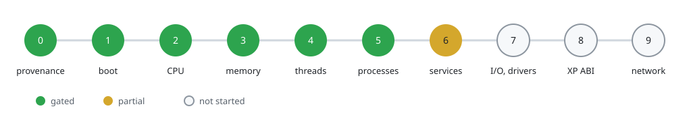

# Anemos

**An open-source operating system kernel, written from scratch and judged against Windows XP's observable behaviour.**

XP is the oracle, not the codebase. The kernel is original C23 for x86_64, boots with Limine in QEMU, and prints its gates over serial. No Microsoft kernel code is in the boot path.

Public repository: <https://github.com/NickLitharis/anemos>

## Roadmap



| Milestone | Status |
|---|---|
| 0 Provenance and architecture | gated |
| 1 Independent boot (Limine, serial) | gated |
| 2 CPU: IDT, PIC, PIT timer | gated |
| 3 Memory: physical pages, paging, bounded heap | gated |
| 4 Threads: cooperative and preemptive, semaphores | gated |
| 5 Processes: isolated roots, ELF64 loader, syscall | gated, bounded slices |
| 6 Kernel services: events, handles, timed waits, wait cancellation | partial; timer objects, IPC, per-process handle tables and security remain |
| 7 I/O, storage, drivers | not started |
| 8 XP-compatible system-call and driver ABI | not started |
| 9 Network integration | not started |

Single CPU. No SMP, general I/O, filesystem, or XP ABI yet.

## Run the boot gate

```sh
./boot/build.sh    # builds the ISO, boots QEMU for 15 s, checks serial output for the AK2–AK6 gates
```

Requires the pinned clang and ld.lld 23.1.3 (`tools/toolchain.lock`), `qemu-system-x86_64`, `genisoimage`, `make` and `curl`. Limine v12.9.6 is downloaded once and SHA-256-checked by the script. Serial output lands in `out/ak3/serial.log`.

## Libraries and host gates

`anemos/` holds the P0–P4 user-mode libraries (codecs, crypto, NLS, Winsock, DNS, DHCP) that predate the kernel and will sit on top of it. They build as i686 PE with the pinned llvm-mingw clang and run under `wine`. There are 13 gates; for example:

```sh
anemos/dns/run.sh        # DNS codec and client
anemos/dhcp/run.sh       # DHCP codec and client
anemos/statusdos/run.sh  # NT status to DOS error mapping
tools/abi/run.sh         # clang vs MSVC struct-layout gate
```

## How correctness is checked

- **A check that cannot fail is not a check.** Gates carry negative controls: a broken implementation or a no-op stub must fail them.
- **The implementation is not its own oracle.** Host-side wire-format gates diff against an independent implementation over valid, truncated and mutated inputs.
- **XP is the reference.** Where Anemos differs from XP, the difference is recorded; XP is not changed to match a test.

## Provenance

The repository contains no Microsoft-origin kernel or boot code. Older XP-derived experiments were removed from the checkout and history, and the cleaned history was force-pushed; clones made before that must be recreated. The ignored `Source/` directory is an external reference, is never modified or shipped, and is not part of this project. See [SCOPE.md](SCOPE.md) and [NOTICE.md](NOTICE.md).

## Where to read next

- [PLAN.md](PLAN.md): the authoritative plan and the measured state of every milestone
- [CHANGELOG.md](CHANGELOG.md): what changed, with dates
- [docs/OS-CODING-RULES.md](docs/OS-CODING-RULES.md): the rules the kernel is written to
- [docs/SIZE-POLICY.md](docs/SIZE-POLICY.md): size budgets for each subsystem
- [PHASES.md](PHASES.md): git tags marking the P0–P4 phase boundaries

## License

MIT for this project's own code, as listed in [SCOPE.md](SCOPE.md). Nothing in `Source/` is licensed to you.
